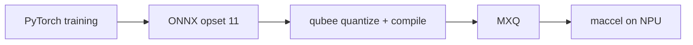

# Super-resolution and NPU deep-learning labs

Coursework from the Deep Learning for edge devices series (DATA 255, San José State University): train a small vision model, then make it fast on a Mobilint NPU.

| Lab | Folder | Status |
|---|---|---|
| Lab 2: DenoiseSRNet, ONNX to MXQ, NPU benchmark | [`lab2_denoisesrnet`](lab2_denoisesrnet) | Complete: **18.3x faster than CPU, 22.400 dB on the NPU** |
| Lab 3: 2x super-resolution with LiteSRNet, ONNX to MXQ, NPU benchmark | [`lab3_litesrnet`](lab3_litesrnet) | Complete: **4.2x faster than CPU, 24.283 dB on the NPU** |

Other SRNet variants explored during Lab 3 (SwiftSRNet, TinySRNet, FastSRNet) and the earlier labs will be added as they are cleaned up.

Author: Vrushabh Bodarya

## Notebooks

Main notebooks: [`Lab2_DenoiseSRNet.ipynb`](notebooks/Lab2_DenoiseSRNet.ipynb) and [`Lab3_LiteSRNet.ipynb`](notebooks/Lab3_LiteSRNet.ipynb) (original runs with saved outputs).

Earlier and alternative iterations are in [`notebooks/experiments/`](notebooks/experiments). The figures below are the validation PSNR printed in each notebook (PyTorch, not on the NPU):

| Notebook | Parameters | Printed result |
|---|---|---|
| `Lab2_ResUNet_v4` | 62,197,891 | log stops at epoch 7 of 100 (19.88 to 21.19 dB) |
| `Lab2_LightResUNet_v5` | 3,239,171 | best validation PSNR 21.93 dB |
| `Lab2_v6` | 3,237,831 | best validation PSNR 21.81 dB |
| `Lab2_SuperResolution_v2` | not printed | no PSNR output saved |
| `Lab3_FastSRNet` | 307,899 | 23.35 dB at epoch 50 of 150 |
| `Lab3_SwiftSRNet` / `_copy` | 1,453,819 (copy) | best 24.13 dB (epoch 294) |
| `Lab3_SwiftSRNet_v2` | 1,935,003 | best 24.22 dB (epoch 350) |
| `Lab3_TinySRNet_v3` | 710,307 | best 24.21 dB, notebook states the 24.3 dB target was not reached |

Compare with the headline models in this repository: DenoiseSRNet (2,751,747 parameters) 22.423 dB and LiteSRNet (581,339 parameters) 24.283 dB. The variants are not independently re-run, and none of them has an NPU speed-up recorded here.

Student identifiers and Colab account metadata were removed; code and outputs are unchanged.

