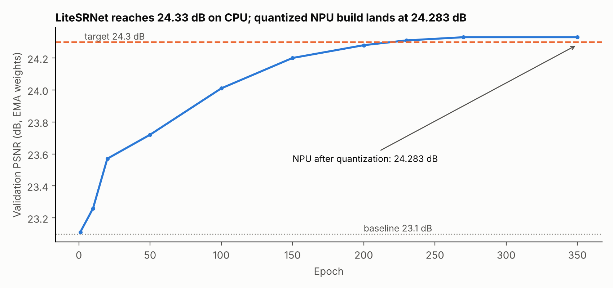
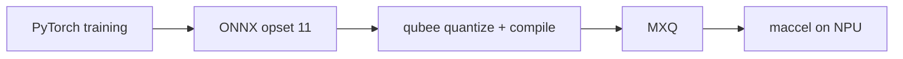

# Super-resolution and NPU deep-learning labs

Coursework from the Deep Learning for edge devices series (DATA 255, San José State University): train a small vision model, then make it fast on a Mobilint NPU.

| Lab | Folder | Status |
|---|---|---|
| Lab 3: 2x super-resolution with LiteSRNet, ONNX to MXQ, NPU benchmark | [`lab3_litesrnet`](lab3_litesrnet) | Complete: **4.2x faster than CPU, 24.283 dB on the NPU** |

Other SRNet variants explored during Lab 3 (SwiftSRNet, TinySRNet, FastSRNet) and the earlier labs will be added as they are cleaned up.

Author: Vrushabh Bodarya
