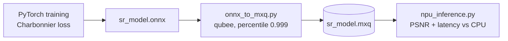

# Lab 2: DenoiseSRNet on the Mobilint NPU

A 2.75M-parameter super-resolution network (DenoiseSRNet) trained with a Charbonnier loss, exported to ONNX, quantized and compiled to MXQ with Mobilint's `qubee`, then benchmarked against CPU inference.

## Result

| | CPU (ONNX Runtime) | NPU (MXQ) |
|---|---|---|
| Mean PSNR, 100 validation images | 22.423 dB | 22.400 dB |
| Latency per 256x256 image | 1578.60 ms | **86.07 ms** |
| Speedup | | **18.3x** |

Quantization cost 0.023 dB. The script's course scoring estimate for this result was 14 / 19.

## Files

| File | Purpose |
|---|---|
| `onnx_to_mxq.py` | Builds calibration data from images and compiles the ONNX model (quantization mode 2, per-channel, percentile 0.999, top-k ratio 0.01) |
| `npu_inference.py` | Evaluates PSNR and latency on CPU and NPU |
| `results/npu_evaluation.md` | The final numbers above |

## Notes

- The scripts need the Mobilint `qubee` compiler, the `maccel` runtime and an NPU.
- They were rebuilt from the originals in my course Drive, so whitespace and comments may differ slightly.
- The training notebook (model definition and training loop) is not in this repository yet; this folder only has the deployment half and the measured results.
- The dataset is not included.
