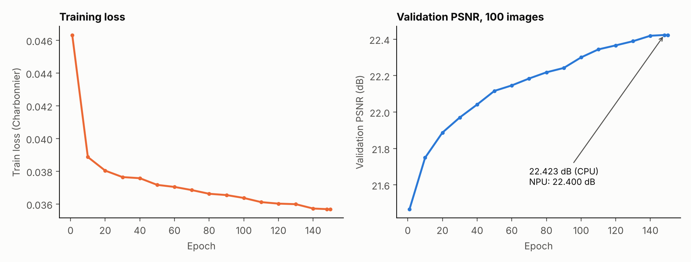
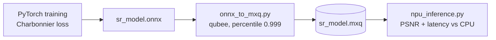

# Lab 2: DenoiseSRNet on the Mobilint NPU

A 2.75M-parameter super-resolution network (DenoiseSRNet) trained with a Charbonnier loss, exported to ONNX, quantized and compiled to MXQ with Mobilint's `qubee`, then benchmarked against CPU inference.

## Result

| | CPU (ONNX Runtime) | NPU (MXQ) |
|---|---|---|
| Mean PSNR, 100 validation images | 22.423 dB | 22.400 dB |
| Latency per 256x256 image | 1578.60 ms | **86.07 ms** |
| Speedup | | **18.3x** |

Quantization cost 0.023 dB. The script's course scoring estimate for this result was 14 / 19.

## Files

| File | Purpose |
|---|---|
| `model.py` | DenoiseSRNet: 16 scaled residual blocks (BatchNorm, 0.1 scale), 96 channels, global residual |
| `train.py` | Training: 128px random crops, flips and rotations, Charbonnier loss, Adam 2e-4 with cosine decay, gradient clipping, 150 epochs |
| `export_onnx.py` | Single-file ONNX export (opset 11, 1x3x256x256) with a PyTorch vs ONNX Runtime check (max difference 1.6e-4 in my run) |
| `results/training_log.csv` | Training log at every 10th epoch plus the first and best epochs |
| `onnx_to_mxq.py` | Builds calibration data from images and compiles the ONNX model (quantization mode 2, per-channel, percentile 0.999, top-k ratio 0.01) |
| `npu_inference.py` | Evaluates PSNR and latency on CPU and NPU |
| `results/npu_evaluation.md` | The final numbers above |

## Notes

- The scripts need the Mobilint `qubee` compiler, the `maccel` runtime and an NPU.
- They were rebuilt from the originals in my course Drive, so whitespace and comments may differ slightly.
- `model.py`, `train.py` and `export_onnx.py` are the notebook's cells split into scripts. Training data was 3,325 LR/HR pairs from five zip archives, validation 100 pairs.
- The training log keeps only epochs I read directly from the notebook output; the curve is drawn from those points, not interpolated.
- Validation PSNR was still rising slowly at the end of training (22.30 dB at epoch 100, 22.42 dB at epoch 148), and the model did not reach the 23 dB baseline marked in the notebook's chart.
- The dataset is not included.
