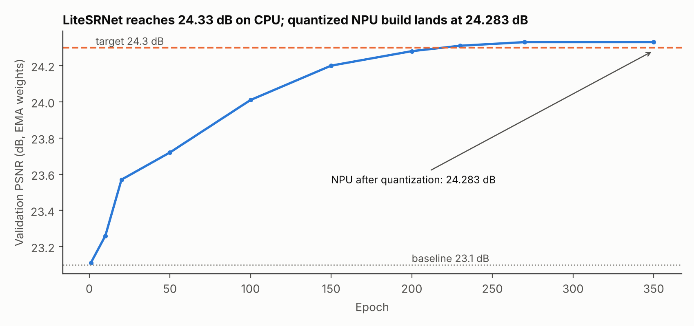
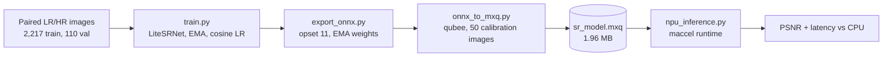

# Lab 3: LiteSRNet, a 2x super-resolution model compiled for the Mobilint NPU

A small residual super-resolution network trained in PyTorch, exported to ONNX, quantized and compiled to an MXQ executable with Mobilint's `qubee` toolchain, and benchmarked on the NPU against CPU inference.

## Result

| | CPU (ONNX Runtime) | NPU (MXQ) |
|---|---|---|
| Mean PSNR, 110 validation images | 24.330 dB | 24.283 dB |
| Latency per 256x256 image | 35.76 ms | **8.57 ms** |
| Speedup | | **4.2x** |

- Quantization cost 0.048 dB of PSNR.
- The course target was PSNR above 24.3 dB. The CPU model passed (24.330 dB). The quantized NPU build landed 0.017 dB short (24.283 dB), so the script's own estimate for the NPU build was 8 / 18 points. This README reports that as it happened.
- GPU latency of the PyTorch model on an A100 was 1.79 ms/image.
- The baseline given with the assignment was 23.1 dB validation / 23.3 dB test.

## Pipeline

## Model

LiteSRNet is a stride-2 encoder, nine residual blocks at 56 channels, a ConvTranspose decoder and a global residual connection. It has **581,339 parameters** (counted from `model.py`).

| Training setting | Value |
|---|---|
| Epochs / batch size | 350 / 16 |
| Optimizer | Adam, lr 3e-4, 10-epoch warmup then cosine decay |
| Loss | L1 |
| Stabilizers | EMA weights (0.999), AMP, gradient clipping 1.0 |
| Seed | 42 |

## Files

| File | Purpose |
|---|---|
| `model.py` | LiteSRNet definition |
| `train.py` | Training loop with EMA and cosine schedule |
| `export_onnx.py` | Exports the EMA weights to ONNX opset 11 |
| `onnx_to_mxq.py` | Quantizes and compiles the ONNX model for the NPU |
| `npu_inference.py` | Runs CPU and NPU evaluation and prints PSNR and latency |
| `make_chart.py` | Draws the training curve from `results/training_log_psnr.csv` |
| `results/` | Logged validation PSNR and the NPU evaluation table |

## Notes

- `onnx_to_mxq.py` and `npu_inference.py` need the Mobilint `qubee` compiler and `maccel` runtime and a Mobilint NPU, so they cannot run on a normal machine. `model.py`, `train.py` and `export_onnx.py` run anywhere PyTorch does.
- Run the scripts from this folder with `python3 <script>` so that `model` imports.
- `results/training_log_psnr.csv` lists only the epochs I read directly from the training log (10 points, not every epoch). The final plateau (epochs 270 to 350) is about 24.33 dB, so 270 and 350 are shown at 24.33.
- The dataset is not included.
